<div align="center">

# DeveloperOS

**One workspace for a developer's whole footprint: GitHub, LeetCode, GeeksforGeeks, resume, portfolio, activity, and an AI assistant that knows all of it.**

[](https://github.com/nikhilkumar905/DeveloperOS)
[](https://developeros.page)


</div>

---

## 🔗 Links

| | |
|---|---|
| **Source code** | https://github.com/nikhilkumar905/DeveloperOS |
| **Live demo** | https://developeros.page |
| **Browser extension** | https://developeros.page/extension (install guide and download) |
| **Privacy policy** | https://developeros.page/privacy |

> The app is branded **PersonalOS** in its interface; the project and repository are called **DeveloperOS**.

---

## 📑 Table of contents

1. [What it does](#-what-it-does)
2. [Screenshots](#-screenshots)
3. [Features in depth](#-features-in-depth)
4. [Architecture](#-architecture)
5. [Technology stack](#-technology-stack)
6. [Repository structure](#-repository-structure)
7. [Quick start with Docker](#-quick-start-with-docker)
8. [Stopping and removing Docker](#-stopping-and-removing-docker)
9. [Running each service without Docker](#-running-each-service-without-docker)
10. [Configuration reference](#-configuration-reference)
11. [Connecting integrations](#-connecting-integrations)
12. [AI assistant (RAG) and its evaluation](#-ai-assistant-rag-and-its-evaluation)
13. [Authentication & security](#-authentication--security)
14. [Rate limits](#-rate-limits)
15. [API overview](#-api-overview)
16. [Testing & verification](#-testing--verification)
17. [Troubleshooting](#-troubleshooting)
18. [Deploying to production](#-deploying-to-production)
19. [License](#-license)

---

## 🧭 What it does

DeveloperOS pulls a developer's scattered activity into one dashboard and turns it into something useful:

- **Tracks** GitHub repositories and contributions, LeetCode and GeeksforGeeks progress, and day-to-day coding sessions (through a Chrome extension).
- **Analyses** it into skill scores, strengths, weaknesses, a learning roadmap and an interactive knowledge graph of languages → frameworks → concepts → skills.
- **Produces** an ATS-friendly one-page resume (PDF) and a ready-to-host portfolio website from the same data.
- **Answers questions** about all of it through an AI assistant built on retrieval-augmented generation (RAG): *"Which of my repos use React?"*, *"How many problems have I solved in total?"*, *"What should I learn next?"*

---

## 📸 Screenshots

All screenshots use a fictional demo profile (“Jordan Lee”); no real user data is shown.

| | |
|---|---|
| **Landing page** (dark theme) 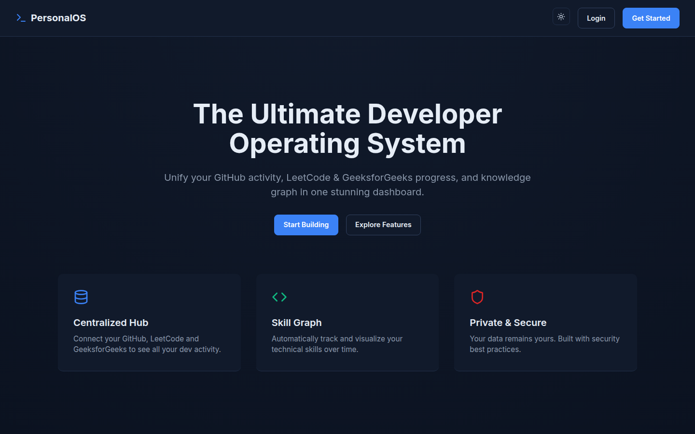 | **Sign-up** with email verification and Google 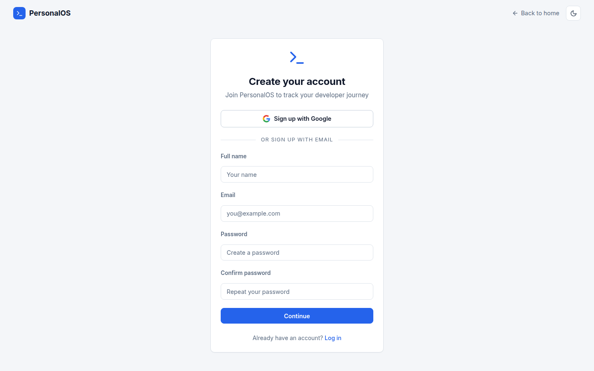 |
| **Overview**: GitHub, LeetCode and GeeksforGeeks side by side 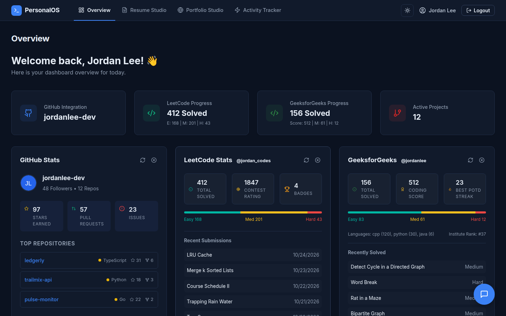 | **AI assistant** answering from the user's own data 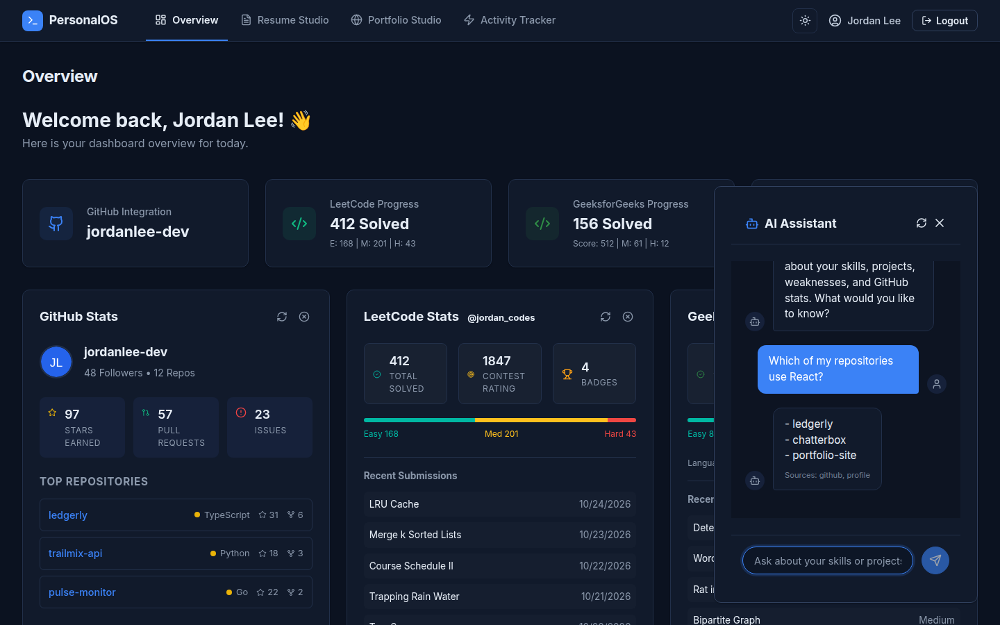 |
| **Developer Intelligence**: scores, strengths, gaps 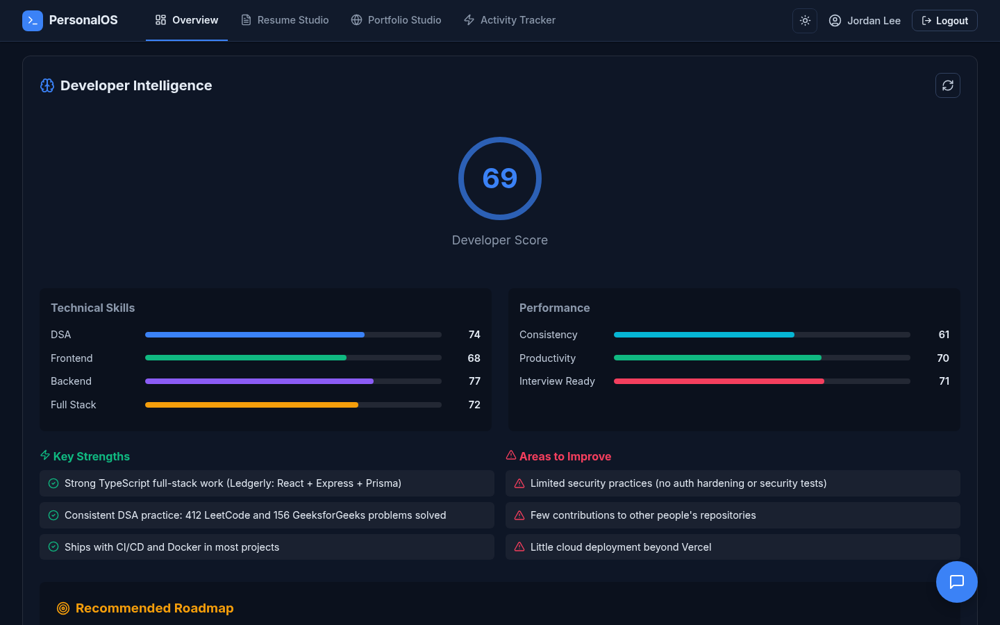 | **Knowledge graph** of technologies and skills 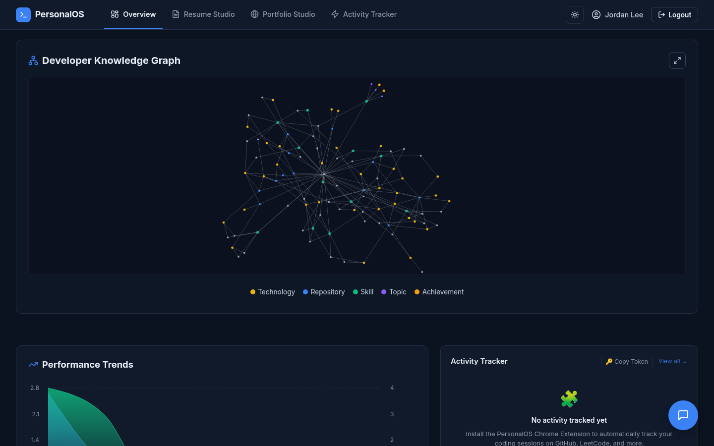 |
| **Resume Studio** with a live one-page preview (light theme) 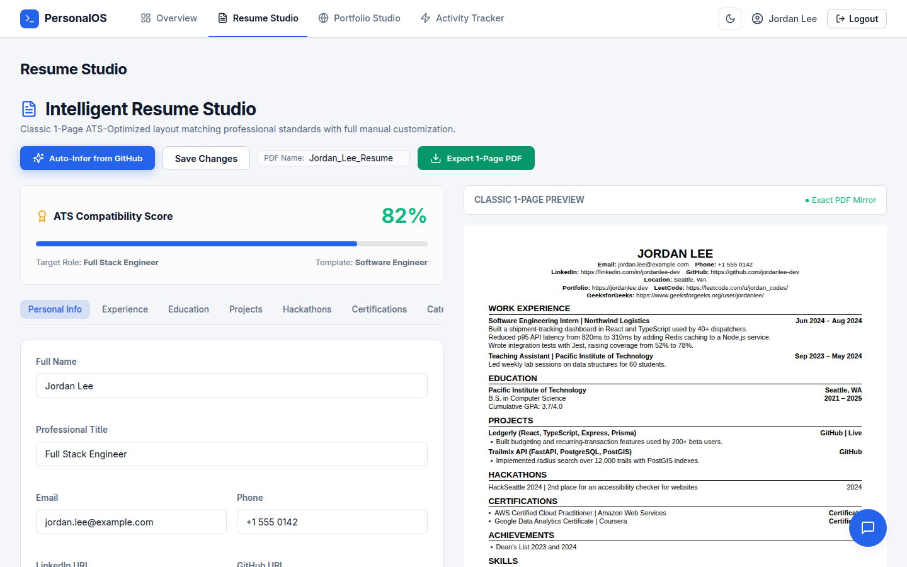 | **Portfolio Studio** with exportable site 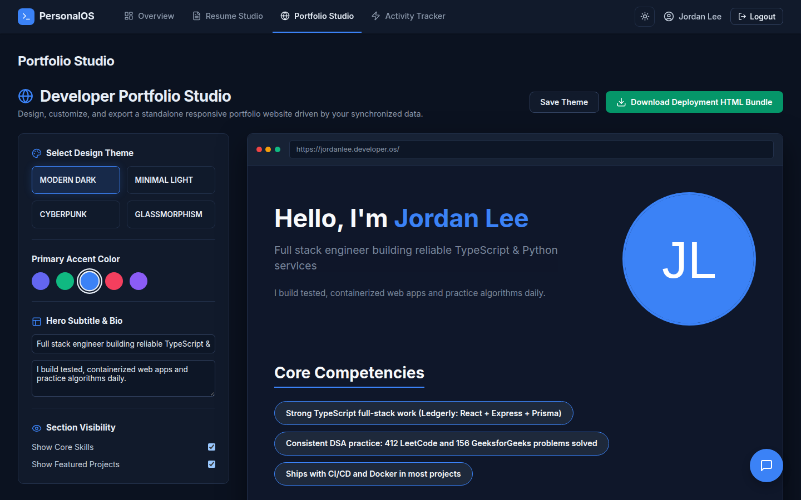 |
| **Activity tracker**: heatmap, yearly trend, platforms 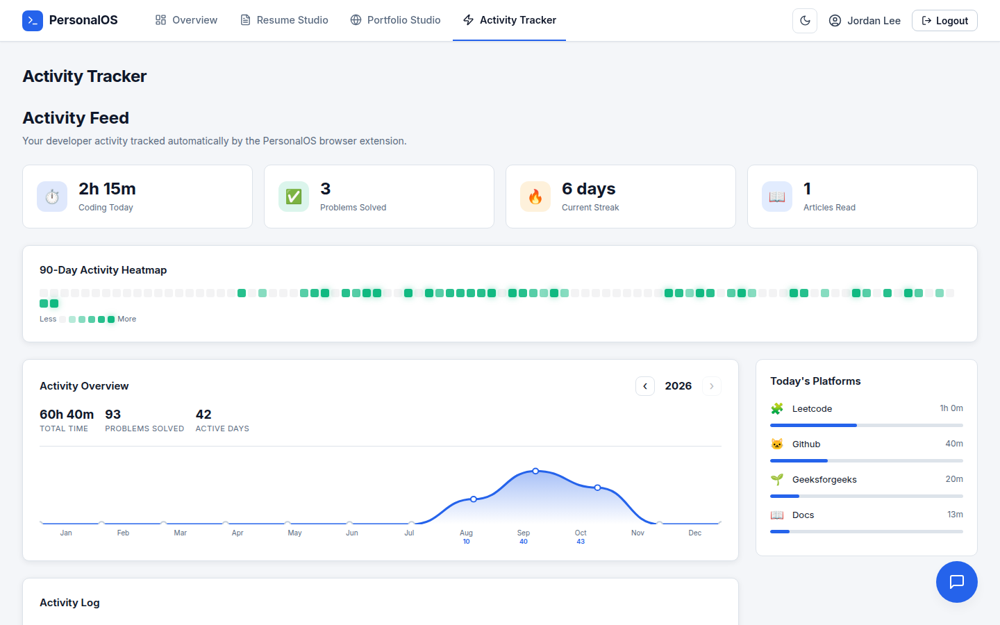 | **Login** 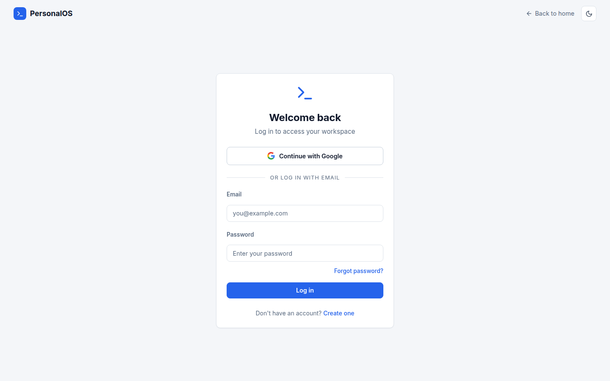 |

---

## ✨ Features in depth

### Integrations
- **GitHub (OAuth).** Imports every repository the user owns: languages, dependencies parsed from `package.json` / `requirements.txt`, file structure, stars, forks, pull requests, issues and an estimate of commits. Re-syncs on demand and every few minutes in the background.
- **LeetCode.** Solved counts by difficulty, contest rating, badges and recent accepted submissions, from LeetCode's public GraphQL API. Only the username is needed.
- **GeeksforGeeks.** Problems solved by difficulty (School → Hard), coding score, problem-of-the-day streaks, institute rank, languages used and recent solves, from GeeksforGeeks' public profile APIs. Only the username is needed.
- **Chrome extension (Manifest V3).** Logs coding sessions on GitHub, LeetCode, GeeksforGeeks, HackerRank, Codeforces, Stack Overflow and documentation sites. It authenticates with a separate, activity-only token.

### Analysis
- **Developer Intelligence.** An LLM scores 13 dimensions (DSA, frontend, backend, full stack, DevOps, AI/ML, databases, security, cloud, consistency, productivity, interview readiness, overall) and writes strengths, weaknesses, recommendations and a roadmap grounded in the user's real repositories and stats. If the LLM is unavailable, a deterministic rule-based scorer takes over, so the dashboard never breaks. Results are cached for 24 hours and refreshed automatically when a platform is connected or its stats change.
- **Knowledge graph.** Repositories, technologies, concepts, skills, domains and achievements as an interactive force-directed graph, built from dependencies, file paths (e.g. `Dockerfile`, `.github/workflows`, `prisma/schema.prisma`) and DSA progress.

### Outputs
- **Resume Studio.** Generates a resume from the user's data. It never invents contact details, education or certifications; those are left for the user. Re-generating keeps anything the user typed by hand. Features a live one-page preview that mirrors the exported **PDF** exactly, plus an **ATS score** with keyword-match suggestions.
- **Portfolio Studio.** Four themes, an accent colour, hero text and section toggles, with a live preview. Exports a self-contained, safely escaped **HTML bundle** ready for any static host.

### Workspace
- **Overview dashboard** with goals, notifications, an activity timeline, performance trends and a 90-day heatmap.
- **Professional dark and light themes** with a toggle, remembered per browser.
- **AI assistant**, available on every page, with conversation history and source attribution (see [the RAG section](#-ai-assistant-rag-and-its-evaluation)).

---

## 🏗 Architecture

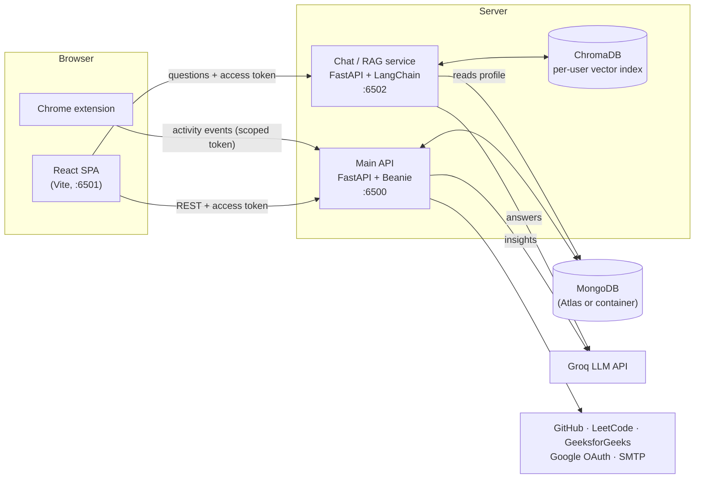

| Service | Folder | Port | Responsibility |
|---|---|---|---|
| **Frontend** | `frontend/` | 6501 | React 19 single-page app; in Docker it's served by Nginx. |
| **Main API** | `fastapi-backend/` | 6500 | Authentication, integrations, analytics, knowledge graph, resume/portfolio generation, activity tracking. |
| **Chat service** | `chat-service/` | 6502 | Indexes each user's profile into ChromaDB and answers questions with retrieval-augmented generation. |
| **MongoDB** | (container or Atlas) | 27017 | All application data. Both Python services read the same database. |
| **Chrome extension** | `extensions/chrome/` | – | Sends activity events to the API. |

**How a request flows:** the SPA keeps a 15-minute access token in memory and sends it as `Authorization: Bearer …` to both Python services. Both verify the same signed JWT (issuer, audience, type and the user's token version), so revoking a user's sessions cuts off both services at once. When the access token expires, the SPA silently renews it using an `httpOnly` refresh cookie.

---

## 🧰 Technology stack

| Layer | Technologies |
|---|---|
| **Frontend** | React 19, TypeScript, Vite 8, React Router 7, Recharts, react-force-graph, Axios, lucide-react |
| **Main API** | Python 3.12, FastAPI, Beanie ODM on Motor (async MongoDB), Pydantic v2, python-jose (JWT), bcrypt, slowapi (rate limiting), httpx, ReportLab (PDF) |
| **AI / RAG** | LangChain, ChromaDB, `all-MiniLM-L6-v2` embeddings on ONNX Runtime (no PyTorch), BM25 + embedding hybrid retrieval, Groq (`openai/gpt-oss-20b`) |
| **Data** | MongoDB 7 (local container or MongoDB Atlas) |
| **Auth** | Email OTP, Google OpenID Connect (PKCE), rotating refresh tokens, SMTP email |
| **Infrastructure** | Docker, Docker Compose, Nginx, GitHub Actions CI |
| **Extension** | Chrome Manifest V3, TypeScript, Webpack |

---

## 📁 Repository structure

```
DeveloperOS/
├── fastapi-backend/            # Main API
│   ├── main.py                 #   app setup: CORS, security headers, rate limiter, routers
│   ├── config/database.py      #   MongoDB + Beanie initialisation
│   ├── middleware/             #   auth dependencies (access / extension tokens, CSRF) and rate limiting
│   ├── models/                 #   Beanie documents (users, tokens, stats, resume, activity, …)
│   ├── routers/                #   auth, dashboard, github, leetcode, gfg, analytics, graph, resume, portfolio, activity
│   ├── services/               #   integrations, analytics engine, knowledge graph, resume/PDF/portfolio, auth, email, Google OAuth
│   ├── requirements.txt
│   └── Dockerfile
├── chat-service/               # RAG chat service
│   ├── main.py                 #   endpoints, JWT verification, per-user limits
│   ├── indexer.py              #   turns a profile into retrievable documents (incl. the repository catalog)
│   ├── rag_engine.py           #   hybrid retrieval, context packing, prompt, Groq call
│   ├── rate_limit.py           #   per-user sliding-window limits
│   ├── eval/                   #   RAG benchmark: fixture profile, 46 labelled questions, runner, results
│   ├── requirements.txt
│   └── Dockerfile
├── frontend/                   # React SPA (Vite)
│   ├── src/pages/              #   Landing, Login, Register, ForgotPassword, Dashboard, Resume, Portfolio, Activity
│   ├── src/components/         #   widgets, chat, resume preview, theme toggle, auth widgets
│   ├── src/context/            #   AuthContext (in-memory tokens, silent refresh) and ThemeContext
│   ├── nginx.conf
│   └── Dockerfile
├── extensions/chrome/          # Activity-tracking browser extension
├── docs/
│   ├── RAG_EVALUATION.md       #   RAG benchmark report
│   ├── screenshots/            #   images used in this README
│   └── *.md                    #   design notes: architecture, database, features, security, roadmap, …
├── docker-compose.yml          # Whole stack: mongo, backend, chat, frontend
├── .env.example                # Configuration template (copy to .env)
└── .github/workflows/ci.yml    # CI: backend import check, frontend lint/build, extension build, compose validation
```

---

## 🐳 Quick start with Docker

**Prerequisites:** Docker with the Compose plugin (`docker compose version`). Allow about 2 GB of disk for the images.

```bash
# 1. Get the code
git clone https://github.com/nikhilkumar905/DeveloperOS.git
cd DeveloperOS

# 2. Configure
cp .env.example .env
#    then edit .env. Only JWT_SECRET is required. Generate one with:
python -c "import secrets; print(secrets.token_urlsafe(48))"

# 3. Build and start everything (first build takes several minutes)
docker compose up --build -d

# 4. Check that all services are healthy
docker compose ps
```

Then open:

| What | URL |
|---|---|
| App | http://localhost:6501 |
| API health | http://localhost:6500/api/health |
| Interactive API docs (development only) | http://localhost:6500/docs |
| Chat service health | http://localhost:6502/api/health |

**What you get without optional keys:**

- **No Groq key:** the AI assistant shows an error, and insights use rule-based scoring.
- **No SMTP settings:** verification codes are printed in the backend logs (`docker compose logs backend`).
- **No Google keys:** the Google button is shown but disabled.

By default the stack uses the bundled MongoDB container. To use **MongoDB Atlas**, set `DOCKER_MONGO_URI` in `.env`.

### Everyday Docker commands

```bash
docker compose logs -f backend        # follow one service's logs (backend | chat | frontend | mongo)
docker compose restart backend        # restart one service after changing .env
docker compose up --build -d frontend # rebuild one service after code changes
docker compose exec backend sh        # shell inside a container
```

---

## 🧹 Stopping and removing Docker

```bash
docker compose stop                   # stop containers, keep them and all data
docker compose down                   # remove containers and network; keep data volumes and images
docker compose down -v                # also delete the data volumes (local MongoDB data + vector index). Irreversible!
docker compose down -v --rmi local    # also delete the images built for this project
docker image prune                    # optionally clean up dangling images left over from rebuilds
```

`down -v` only deletes the **bundled** MongoDB container's data. A MongoDB Atlas database is never affected.

---

## 🛠 Running each service without Docker

Useful for development, or if you'd rather not install Docker. Each service runs on its own and reads its own `.env` file.

### 0. Prerequisites
- **Python 3.12**, **Node.js 20.19+** (or 22+), **npm**
- **MongoDB**: either a local server on `mongodb://localhost:27017` or a MongoDB Atlas connection string

### 1. Main API (`fastapi-backend/`)

```bash
cd fastapi-backend
python -m venv .venv
source .venv/bin/activate              # Windows: .venv\Scripts\activate
pip install -r requirements.txt
```

Create `fastapi-backend/.env`:

```env
MONGO_URI=mongodb://localhost:27017      # or your Atlas connection string
JWT_SECRET=<at least 32 random characters>
FRONTEND_URL=http://localhost:6501
GROQ_API_KEY=<optional>
# optional integrations: GITHUB_*, GOOGLE_*, SMTP_* (see the configuration reference)
```

```bash
python -m uvicorn main:app --port 6500 --reload
```

### 2. Chat service (`chat-service/`)

```bash
cd chat-service
python -m venv .venv
source .venv/bin/activate              # Windows: .venv\Scripts\activate
pip install -r requirements.txt
cp .env.example .env                    # same MONGO_URI and the SAME JWT_SECRET as the API, plus GROQ_API_KEY
python main.py                          # serves on :6502
```

The first start downloads the embedding model (~80 MB, ONNX format).

### 3. Frontend (`frontend/`)

```bash
cd frontend
npm install
cp .env.example .env                    # VITE_API_URL=http://localhost:6500, VITE_CHAT_API_URL=http://localhost:6502
npm run dev -- --port 6501              # development server
# or: npm run build && npm run preview  # production build
```

### 4. Chrome extension (`extensions/chrome/`)

```bash
cd extensions/chrome
npm install
npm run build                           # outputs extensions/chrome/dist
```

1. Open `chrome://extensions`, enable **Developer mode**, click **Load unpacked** and pick `extensions/chrome/dist`.
2. In the popup, set **Server URL** to your API (`http://localhost:6500` locally; the default is `https://api.developeros.page`).
3. In the app, open the **Activity Tracker** widget, click **Copy Token**, and paste it into the extension popup. This token can only log and read activity.

`npm run package` builds the extension and creates `developeros-extension.zip`, the file served from `frontend/public/downloads/` for the website's download button. **End users** get the extension from the [/extension](https://developeros.page/extension) page. To publish it on the Chrome Web Store, see [docs/EXTENSION.md](docs/EXTENSION.md).

### Running only part of the stack

The services are independent apart from the shared database and JWT secret:

- **Frontend + API only:** everything works except the AI assistant.
- **API only:** usable through http://localhost:6500/docs.
- **Mix Docker and local:** for example, run MongoDB in Docker and the rest locally with `docker compose up -d mongo`.

---

## ⚙ Configuration reference

Docker reads the root `.env` (template: `.env.example`). Without Docker, each service reads its own `.env`. **Never commit `.env` files**; they are git-ignored.

| Variable | Used by | Required | Purpose |
|---|---|---|---|
| `JWT_SECRET` | API, chat | **Yes** | Signs all tokens. At least 32 random characters, identical in both services. |
| `MONGO_URI` / `DOCKER_MONGO_URI` | API, chat | Yes / no | MongoDB connection. Without Docker use `MONGO_URI` in each service's `.env`. In Docker, `DOCKER_MONGO_URI` (empty = bundled container). |
| `MONGO_DB_NAME` | API, chat | No | Database name (default `personalos`). |
| `APP_ENV` | API | No | `development` (default) or `production`. Production enables Secure cookies, hides API docs and requires SMTP. |
| `FRONTEND_URL` | API, chat | No | Frontend origin for CORS and OAuth redirects (default `http://localhost:6501`). |
| `CORS_ORIGINS` | API, chat | No | Extra allowed browser origins, comma-separated. |
| `COOKIE_SECURE` | API | No | Force Secure cookies on or off (defaults to on in production). |
| `GROQ_API_KEY` | API, chat | No | LLM for the assistant and AI insights. |
| `GROQ_MODEL` | API, chat | No | Defaults to `openai/gpt-oss-20b`. |
| `GITHUB_CLIENT_ID` / `GITHUB_CLIENT_SECRET` / `GITHUB_CALLBACK_URL` | API | No | GitHub repository import. |
| `GOOGLE_CLIENT_ID` / `GOOGLE_CLIENT_SECRET` / `GOOGLE_REDIRECT_URI` | API | No | Sign in with Google. |
| `SMTP_HOST` / `SMTP_PORT` / `SMTP_USER` / `SMTP_PASSWORD` / `SMTP_FROM` | API | No (yes in production) | Sending verification and password-reset codes. |
| `ACCESS_TOKEN_TTL_MIN` / `REFRESH_TOKEN_TTL_DAYS` / `EXTENSION_TOKEN_TTL_DAYS` | API | No | Token lifetimes (15 min / 14 days / 90 days). |
| `CHAT_PER_MINUTE` / `CHAT_PER_DAY` / `INDEX_PER_HOUR` | chat | No | Per-user assistant limits (10 / 200 / 6). |
| `PUBLIC_API_URL` / `PUBLIC_CHAT_API_URL` | frontend build (Docker) | No | API URLs compiled into the frontend. Must be reachable from the browser. |
| `VITE_API_URL` / `VITE_CHAT_API_URL` | frontend (no Docker) | No | Same as above, for `frontend/.env`. |
| `CHAT_PORT` / `CHROMA_DIR` / `EMBED_THREADS` | chat | No | Port (6502), vector index folder, CPU threads used for embeddings (default 2). |

---

## 🔌 Connecting integrations

<details>
<summary><b>Groq (AI assistant and insights)</b></summary>

1. Create a free account at https://console.groq.com and create an **API key**.
2. Set `GROQ_API_KEY` for the API and chat service, then restart them.

The key is only used on the server; the browser never sees it. Per-user [rate limits](#-rate-limits) stop any single account from using up the quota.
</details>

<details>
<summary><b>GitHub repository import</b></summary>

1. GitHub → Settings → Developer settings → **OAuth Apps → New OAuth App**.
2. Homepage URL `http://localhost:6501`, callback URL `http://localhost:6500/api/github/callback`.
3. Set `GITHUB_CLIENT_ID` and `GITHUB_CLIENT_SECRET`, then restart the API.
4. In the app, click **Connect GitHub** on the Overview page.
</details>

<details>
<summary><b>Sign in with Google</b></summary>

1. Google Cloud Console → create a project.
2. **OAuth consent screen** (Google Auth Platform): set the app name and support email, audience **External**, and add your Gmail address as a **test user**.
3. **Credentials → OAuth client ID → Web application**:
   - Authorized JavaScript origin: `http://localhost:6501`
   - Authorized redirect URI: `http://localhost:6500/api/auth/google/callback`
4. Set `GOOGLE_CLIENT_ID`, `GOOGLE_CLIENT_SECRET` and `GOOGLE_REDIRECT_URI`, then restart the API.

While the app is in Google's "testing" mode, only listed test users can sign in. Publish the consent screen to open it to everyone.
</details>

<details>
<summary><b>Email verification codes (Gmail SMTP)</b></summary>

1. Turn on **2-Step Verification** for the Gmail account (Google only issues App Passwords once it's on).
2. Create an **App Password** at https://myaccount.google.com/apppasswords.
3. Set:
   ```env
   SMTP_HOST=smtp.gmail.com
   SMTP_PORT=587
   SMTP_USER=you@gmail.com
   SMTP_PASSWORD=<16-character app password>
   SMTP_FROM=PersonalOS <you@gmail.com>
   ```
Any SMTP provider works, for example Brevo, SendGrid or Mailgun; just use their host, port and credentials.
</details>

<details>
<summary><b>LeetCode and GeeksforGeeks</b></summary>

No keys are needed. Enter the username in the LeetCode or GeeksforGeeks card on the Overview page. Only **public** profile data is read. The app doesn't verify that the username belongs to the signed-in user.
</details>

---

## 🤖 AI assistant (RAG) and its evaluation

**Indexing.** When a user first chats (or clicks *Update Knowledge Base*), the chat service loads their profile from MongoDB. It turns the profile into ~45 focused documents: an overview, one per repository, a **repository catalog** listing every repo with its language, libraries, stars and CI/Docker/live-demo flags, the LeetCode and GFG stats, resume sections, AI insights, recent activity and knowledge-graph relationships. These are embedded into a **per-user ChromaDB collection**, so users' data is never mixed. The index is versioned and rebuilt automatically when the format changes.

**Retrieval** for each question:
1. **Entity matching:** repository, project and company names mentioned in the question (`trailmix api` matches `trailmix-api`).
2. **Keyword routes:** e.g. *gfg* goes to the GeeksforGeeks doc, *certifications* to that resume section.
3. **Repository catalog** for portfolio-wide questions (*which / list / how many / most … repos*).
4. **Hybrid search:** BM25 keyword ranking fused with embedding similarity by reciprocal rank fusion. This catches exact names like `socket.io` that small embedding models blur.
5. **The overview goes last.** Context is packed into a fixed budget (6,000 characters) so requests stay within Groq's free tier.

**Generation.** A short system prompt requires answers to come only from the context, numbers to be quoted exactly, list questions to be filtered item by item, and a plain "I don't have that information" when the context lacks the answer. Follow-up questions use recent conversation history.

**Evaluation.** A benchmark of 46 labelled questions on a synthetic profile measures both retrieval and answers. Full report: **[docs/RAG_EVALUATION.md](docs/RAG_EVALUATION.md)**.

| Metric | Before improvements | After |
|---|---:|---:|
| Answer accuracy | 93.5% | **100%** |
| Portfolio-wide ("which repos use X?") questions | 57% | **100%** |
| Needed evidence reached the LLM | 92.7% | **100%** |
| MRR (rank of first relevant document) | 0.50 | **0.94** |
| Hallucination rate / correct refusals on unanswerable questions | 0% / 100% | 0% / 100% |
| Answer latency p50 / p95 | – | 0.62 s / 1.46 s |

```bash
cd chat-service
.venv/bin/python eval/run_eval.py --label dev --retrieval-only   # retrieval metrics in seconds, no LLM calls
.venv/bin/python eval/run_eval.py --label dev --pace 20          # full run (~18 min on Groq's free tier)
.venv/bin/python eval/compare.py improved dev                    # compare with the published results
```

---

## 🔐 Authentication & security

| Area | How it works |
|---|---|
| **Sign-up** | Email + password, confirmed by a 6-digit code emailed to the user. The account is created only after verification. Codes are stored as keyed hashes, expire in 10 minutes, allow 5 attempts and have a 60-second resend cooldown. |
| **Sign in with Google** | OpenID Connect authorization-code flow with PKCE, `state` and `nonce`. Google's ID token signature (against its published keys), issuer, audience, expiry and verified-email claim are all checked. An existing account with the same email is linked. |
| **Sessions** | 15-minute access tokens are kept **in memory**, never in `localStorage`. The refresh token lives in an `httpOnly`, `SameSite=Strict` cookie scoped to `/api/auth` and is rotated on every use. Replaying a used token revokes the whole session (stolen-token detection). |
| **Revocation** | Each token carries the user's token version. "Log out everywhere" and password resets bump it, instantly invalidating every token, including the extension's and chat access. |
| **Passwords** | bcrypt (cost 12). At least 8 characters with letters and numbers; common passwords and the email itself are rejected. Reset is by emailed code. |
| **Abuse protection** | Per-IP and per-account rate limits. Accounts lock for 15 minutes after 5 failed logins. Responses are identical whether or not an email is registered (register, login lockout, forgot password), so the API can't be used to discover accounts. |
| **Authorization** | Every data endpoint requires an access token and only ever reads or writes the caller's own records. The extension's token can only log and read activity. |
| **Transport & headers** | Explicit CORS allow-list (never `*` with credentials), a CSRF header and Origin check on cookie endpoints, `X-Content-Type-Options`, `X-Frame-Options: DENY`, a strict CSP, `Referrer-Policy`, `no-store` on auth responses, and HSTS over HTTPS. |
| **Output safety** | User text is escaped in the exported PDF and portfolio HTML, so a repository description can't inject markup or scripts. |
| **Containers** | Both Python services run as an unprivileged user. Secrets come only from the environment, and `JWT_SECRET` has no default. |

---

## 🚦 Rate limits

| Endpoint | Limit | Keyed by |
|---|---|---|
| `POST /api/auth/register` | 5 / minute, 30 / hour | IP |
| `POST /api/auth/login` | 10 / minute, 100 / hour (+ lockout after 5 wrong passwords) | IP + account |
| `POST /api/auth/register/resend`, `/password/forgot` | 3 / minute, 20 / hour | IP |
| `POST /api/auth/register/verify`, `/password/reset` | 10 / minute | IP |
| `POST /api/auth/refresh` | 30 / minute | IP |
| `POST /api/analytics/insights/refresh` (LLM) | 5 / hour, 20 / day | account |
| `POST /api/resume/infer` (LLM) | 10 / hour, 40 / day | account |
| `POST /api/chat` (assistant) | 10 / minute, 200 / day (configurable) | account |
| `POST /api/index` (assistant re-index) | 6 / hour | account |

Exceeding a limit returns HTTP **429** with a "please wait" message. Counters are kept in memory per process; use a shared store such as Redis if you run several API workers.

---

## 📡 API overview

All routes are under `/api`. In development the full interactive reference is at **http://localhost:6500/docs**.

| Group | Routes |
|---|---|
| **auth** | `POST register`, `register/verify`, `register/resend`, `login`, `refresh`, `logout`, `logout-all`, `extension-token`, `password/forgot`, `password/reset`, `password/change` · `GET profile`, `config`, `google/login`, `google/callback` |
| **dashboard** | `GET stats`, `goals`, `notifications`, `timeline` · `POST goals` · `PUT notifications/{id}/read` |
| **github** | `GET auth-url`, `callback`, `stats` · `POST sync`, `disconnect` |
| **leetcode**, **gfg** | `POST connect`, `sync`, `disconnect` · `GET stats` |
| **analytics** | `GET insights` · `POST insights/refresh` |
| **graph** | `GET /api/graph` |
| **resume** | `GET profile`, `export/pdf` · `PUT profile` · `POST infer`, `analyze-ats` |
| **portfolio** | `GET settings`, `preview`, `export/bundle` · `PUT settings` |
| **activity** | `POST log` · `GET feed`, `summary`, `weekly`, `heatmap`, `yearly`, `settings` · `PUT settings` · `DELETE logs` |
| **chat service** (`:6502`) | `POST /api/chat`, `POST /api/index`, `GET /api/health` |

---

## ✅ Testing & verification

```bash
# Backend: imports and wiring
cd fastapi-backend && MONGO_URI=mongodb://localhost:27017 JWT_SECRET=$(python -c "import secrets;print(secrets.token_urlsafe(48))") python -c "import main"

# Frontend: type-check, lint and production build
cd frontend && npm run lint && npm run build

# Chrome extension build
cd extensions/chrome && npm run build

# RAG benchmark (see above)
cd chat-service && .venv/bin/python eval/run_eval.py --label dev --retrieval-only

# Docker configuration
JWT_SECRET=check docker compose config -q
```

CI (`.github/workflows/ci.yml`) runs the backend import check, chat-service syntax check, frontend lint and build, the extension build and the Compose validation on every push.

---

## 🩺 Troubleshooting

| Symptom | Cause / fix |
|---|---|
| `docker compose up` says *Set JWT_SECRET in .env* | Copy `.env.example` to `.env` and set `JWT_SECRET`. |
| *Port is already allocated* | Something else is using 6500, 6501, 6502 or 27017. Stop it, or change the left-hand side of the port mappings in `docker-compose.yml`. |
| Chatbot says it can't reach the chat service | The chat service isn't running, or `VITE_CHAT_API_URL` / `PUBLIC_CHAT_API_URL` points to the wrong place. Check http://localhost:6502/api/health. |
| Chatbot says *too many requests* | The per-user assistant limit (10/min, 200/day) or Groq's free-tier limit was reached. Wait and try again. |
| No verification email | Check Spam. Check that the `SMTP_*` settings are set and the API was restarted. Without SMTP in development, the code is in the backend logs. |
| Google: *Access blocked* / *app not verified* | Add your Gmail as a **test user** on the OAuth consent screen, and check that the redirect URI matches exactly. |
| Google: `redirect_uri_mismatch` | `GOOGLE_REDIRECT_URI` must exactly equal the URI registered in Google Cloud. |
| MongoDB *bad auth* | Wrong Atlas username or password. URL-encode special characters (`@` → `%40`). |
| Logged out after updating | Tokens from older versions are no longer accepted. Log in again, and re-copy the extension token. |
| Insights look generic | No Groq key, or Groq is rate-limited. Rule-based scores are shown until the LLM is available. |

---

## 🚀 Deploying to production

**Step-by-step guide for deploying on `developeros.page` with Vercel (frontend) + Render (API and chat service): [docs/DEPLOYMENT.md](docs/DEPLOYMENT.md).** Distributing the browser extension (website download and Chrome Web Store): [docs/EXTENSION.md](docs/EXTENSION.md). The repository already includes `render.yaml` (a Render Blueprint for both backend services) and `frontend/vercel.json` (build settings and page routing).

General checklist for any host:

- Serve over **HTTPS** and set `APP_ENV=production`. Secure cookies and HSTS are enabled, and the interactive API docs are hidden.
- Use a long random `JWT_SECRET`, identical for the API and chat service, and keep all secrets in the host's environment-variable settings, never in the repository.
- Host the frontend and API on the **same site** (e.g. `app.example.com` + `api.example.com`) so the `SameSite=Strict` refresh cookie is sent. Set `FRONTEND_URL`, `CORS_ORIGINS`, `PUBLIC_API_URL` and `PUBLIC_CHAT_API_URL` accordingly, and update the GitHub and Google callback URLs.
- Configure SMTP, which is required in production.
- Rate-limit counters are in memory. For multiple workers or instances, move them to Redis.
- Use MongoDB Atlas (or another managed MongoDB) with network access restricted to your servers.

---

## 📄 License

No license has been chosen yet (the `LICENSE` file is empty), so all rights are reserved by the author. Add a license (e.g. MIT) before inviting outside contributions.

---

<div align="center">
Built by <a href="https://github.com/nikhilkumar905">nikhilkumar905</a>
</div>
